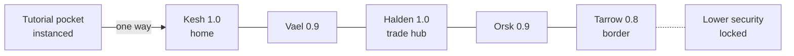
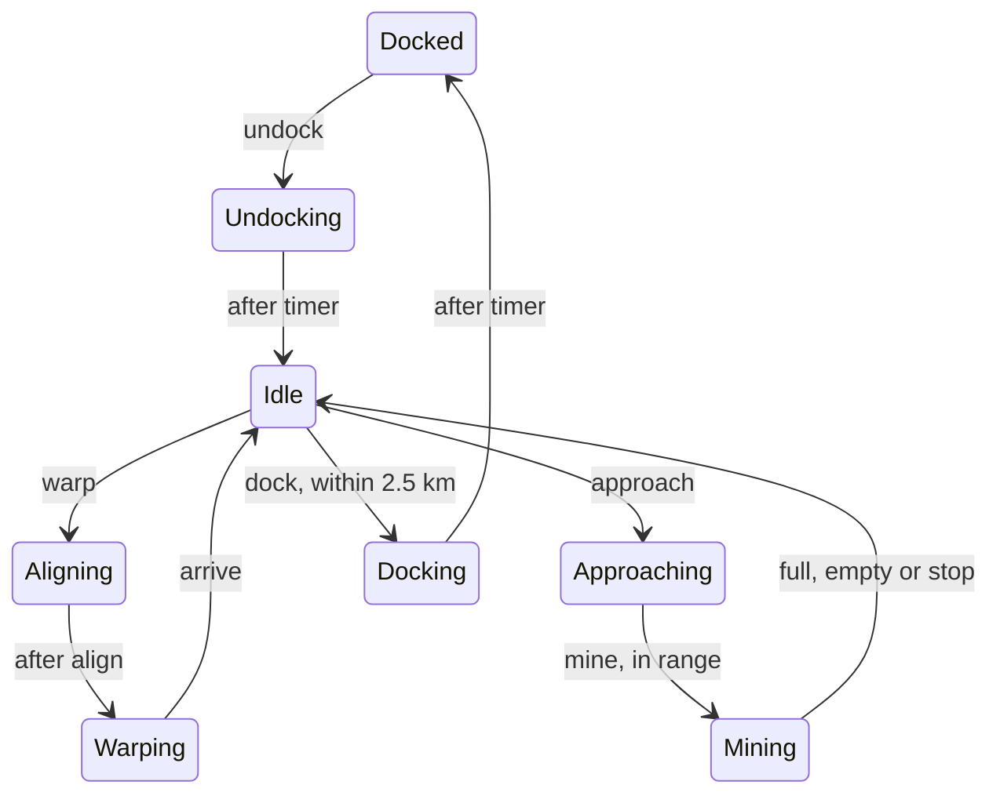

# Starting Cluster & Vertical Slice

Nov 5, 2026 · @Matthew Clayton

## Scope

The slice proves one complete earning loop: a new player learns it alone in a private tutorial pocket, graduates into Kesh, and then earns and spends money there among other players.

**In the slice**

- Station view and its services (shipyard, market, hangar, undock)
- Buying the first ship, as a tutorial step
- Undocking, warping between sites, docking
- Mining, including one rich vein event that rewards paying attention
- Selling ore to NPC buy orders with limited volume
- One upgrade to buy with the earnings (Mining Laser II)
- The tutorial exit gate: one one-way jump into Kesh

**Out of the slice** (designed later, but the slice must not block them)

- Combat, losses and insurance
- Fitting beyond the one upgrade, and a second ship type
- Player-placed market orders
- Gate travel beyond the tutorial exit
- Multiple factions. There is one faction for now, but characters already store faction and home system.
- The public automation API. The slice uses the same command verbs internally, so the API is a thin layer later.

**Done when** a fresh account goes from login through the tutorial to a first sale in Kesh without help, and a second player in Kesh sees them on radar.

## Starting cluster

The cluster is a chain of five high-security systems plus a private tutorial pocket. New players graduate into Kesh, their home system, two jumps from Halden, the trade hub.

Two jumps is deliberate: Kesh develops its own local life, and finding Halden becomes the player's first real trip. Kesh is the spawn for now; spawn locations change once factions and more of the universe arrive.

| System | Security | Role | Station | Belts | Ore | In slice |
| --- | --- | --- | --- | --- | --- | --- |
| Tutorial pocket | 1.0 | Tutorial, instanced per player | Training station (shipyard, market) | 1 training belt | Ferrite | Yes |
| Kesh | 1.0 | Home system | Kesh Station (shipyard, market) | 2 | Ferrite | Yes |
| Vael | 0.9 | Waypoint | Vael Exchange | 2 | Ferrite | No |
| Halden | 1.0 | Trade hub | Halden Prime Station (low fees) | 2 | Ferrite | No |
| Orsk | 0.9 | Industry | Orsk Refinery | 3 | Ferrite | No |
| Tarrow | 0.8 | Border system | Tarrow Watch | 2 | Ferrite, Siltane | No |

The pocket holds only its player. Its rocks and events are scripted, so the training belt never runs dry and the rich vein appears on cue. Once the player leaves through the exit gate, the instance is deleted and cannot be revisited. In Kesh, Belt 2 has NPC miners so the home system never looks empty.

## Core loop

The tutorial runs the first pass alone in the player's private pocket and ends at its exit gate. After that, the player repeats steps 3 to 7 in Kesh. Each step shows its command, since the same verbs will power automation later.

1. **Station view** (`docked`). The player starts docked at the pocket's training station with a credit grant and no ship. The screen lists station services: Shipyard, Market, Hangar, Undock. Undock stays disabled until they own a ship.
2. **Buy a ship** (`buy ship sparrow`). The tutorial opens the Shipyard and points at the Sparrow mining frigate. Buying it puts it in the hangar, already fitted with one mining laser, and makes it the active ship.
3. **Undock** (`undock`). After a short undock timer the ship appears on the station grid, and the radar view replaces the station view.
4. **Warp to a belt** (`warp belt-1`). The player picks a belt from the system list. The ship aligns, then warps; warp time depends on distance. It lands a few kilometres from the nearest asteroid.
5. **Mine** (`approach <rock>`, then `mine <rock>`). The laser needs the rock within range, so the player approaches first. Each cycle moves ore into the hold. Mining stops when the hold is full, the rock is empty, or the player stops it. In the tutorial, a rich vein appears mid-run on cue, to teach that paying attention pays.
6. **Warp back and dock** (`warp station`, `dock`). Docking needs the ship within docking range of the station.
7. **Sell** (`sell ferrite all`). The market shows NPC buy orders; selling fills them and pays out instantly.
8. **Graduate** (`jump exit`, tutorial only). The player undocks and takes the one-way exit gate. They arrive in space on the Kesh Station grid, a few kilometres from the station, and the pocket is deleted behind them.

In Kesh, the first goal is the Mining Laser II upgrade, which takes about two runs to afford.

## Starting numbers

One full loop takes about 12 minutes and earns 4,500 cr. The Sparrow pays for itself in under two runs, and the laser upgrade takes two more. These are tuning starting points, not balance decisions.

| Value | Start at | Reason |
| --- | --- | --- |
| Starting credit grant | 10,000 cr | Buys the Sparrow and leaves a buffer |
| Sparrow price | 6,000 cr | Most of the grant, so the purchase feels real |
| Sparrow ore hold | 500 m³ | Fills in about 10 minutes |
| Mining laser yield | 25 m³ per 30 s cycle | 20 cycles per hold; frequent feedback |
| Mining Laser II | 9,000 cr, 35 m³ per cycle | The first goal after the tutorial |
| Mining laser range | 10 km | Forces an approach step after warp |
| Rich vein | 3× yield, fades after 45 s | Rewards a player who is watching |
| Undock timer | 10 s | Long enough to read, short enough not to annoy |
| Align time | 5 s |  |
| Warp time | 15 to 40 s, by distance | Belts near the station are short trips |
| Docking range | 2.5 km |  |
| Ferrite NPC buy price | 9 cr per m³, fixed | A full hold sells for 4,500 cr |
| NPC order volume | 5,000 m³ per order, refills over hours | Selling feels like a market; ore cannot be dumped endlessly |
| Asteroid size | 2,000 to 8,000 m³ | Two to sixteen holds per rock |
| Asteroid regrowth | Slow, over hours | Shared rocks run out when many players mine |

Ore is our own: **Ferrite** is the common ore found everywhere in the cluster. **Siltane**, a richer ore, appears only in Tarrow, the 0.8 border system, so leaving home has a reason. The radar mockup still says Veldspar, EVE's ore name, and needs updating.

## Server model

The server runs a 1-second tick and owns all state; the client only sends commands and draws what it is told. Space is built from **grids**: each system has sites (the station, each belt, each gate), and a ship on a grid has a position in kilometres. Warp moves a ship from one grid to another.

Every command checks the ship's state first, so `mine` from Warping or `dock` at 8 km is refused with a reason the client can show.

| Entity | Holds |
| --- | --- |
| System | Name, security, list of grids, gate links |
| Grid | Kind (station, belt, gate), position in the system, contents |
| Asteroid | Grid, position, ore type, volume left |
| Ship | Owner, type, state, grid, position, hold contents, active timer |
| Character | Wallet, active ship, docked station, faction, home system, tutorial step |
| Tutorial instance | Owner, template, script state; deleted when the player exits |
| NPC buy order | Station, ore type, price per m³, volume left, refill rate |

Radar only gets what is on the player's own grid. That keeps traffic small and is the first step toward the sensor rules. Before Halden gets busy, the overview needs filters, such as hiding docked or idle ships.

If a player logs out in space, their ship stays for 60 seconds and then warps to safety. Combat later depends on this rule, so it is fixed now.

## Screens and open questions

The slice needs five screens; only the radar exists as a mockup so far.

- [ ] Station view: services list, station name and security, hangar summary
- [ ] Shipyard: ship stats, price, buy confirmation (the tutorial's first real choice)
- [x] Radar / space view (canvas option C, being refined)
- [ ] Mining panel: target rock, cycle timer, hold fill, stop
- [ ] Market: NPC buy orders, sell quantity, payout

**Open questions**

- [ ] Is the tutorial a scripted overlay on the real screens, or an NPC contact giving orders over Comms?
- [ ] Can the player see other players' mining yield, or only that they are mining?
- [ ] Is the ship named by the player at purchase?
- [x] NPC prices: fixed in the slice, with limited order volume
- [x] Logout in space: the ship stays 60 seconds, then warps to safety
- [x] Graduation: the player arrives in space on the Kesh Station grid

## Tech stack

The server and protocol are settled. The client comes down to Godot 4 or Avalonia 12, both in C#, and is decided by a short side-by-side test.

| Layer | Choice | Note |
| --- | --- | --- |
| Server | Rust with tokio | One authoritative process, 1 s tick |
| Storage | Postgres (sqlx) | World lives in memory, saved every few ticks |
| Protocol | Protobuf over TLS | One schema generates server and client code; later the automation API |
| Client | Godot 4 or Avalonia 12, C# | Decided by the test below |
| Steam | Steamworks.NET | Login tickets, achievements, overlay |
| Login | Steam session tickets | No passwords stored |
| Bots and tests | Headless Rust client | Load tests, slice tests, API reference |
| Builds | GitHub Actions | Windows, macOS, Linux on every push; macOS needs Apple notarization ($99 a year) |

### Client test: Godot vs Avalonia

Build the same thing in both, one weekend each, using fake data and no server.

**Build**

- [ ] Station view with the services list and hotkeys
- [ ] Radar: vector rings, sweep, 20 contacts moving every second
- [ ] Overview list with 200 rows, sorting and filters
- [ ] Command line with history and tab completion
- [ ] Theme swap at runtime between Standard and one other theme

**Check**

- [ ] Steam overlay opens (Shift+Tab) on Windows, macOS and Linux
- [ ] Steam Deck: every screen works with the controller alone
- [ ] Glow on radar lines without hurting frame rate
- [ ] Sound: UI click, mining cycle, alert
- [ ] High-DPI and ultrawide scaling
- [ ] Crisp monospace text at 11 to 14 px, and non-Latin input in the command line
- [ ] Generated protobuf client compiles and connects to a stub server
- [ ] CI builds run on all three systems, and the macOS build notarizes
- [ ] Low CPU and GPU use while docked, since players leave menu games open for hours

**Decide:** the overlay and Steam Deck checks are pass or fail. If both engines pass, pick the one where building screens felt faster.
